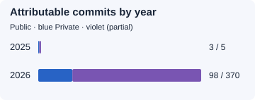
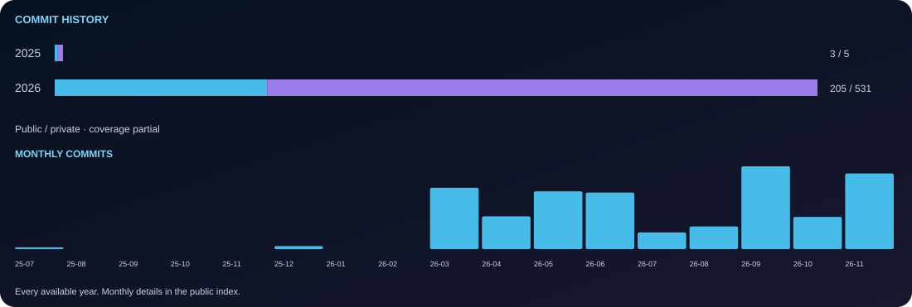
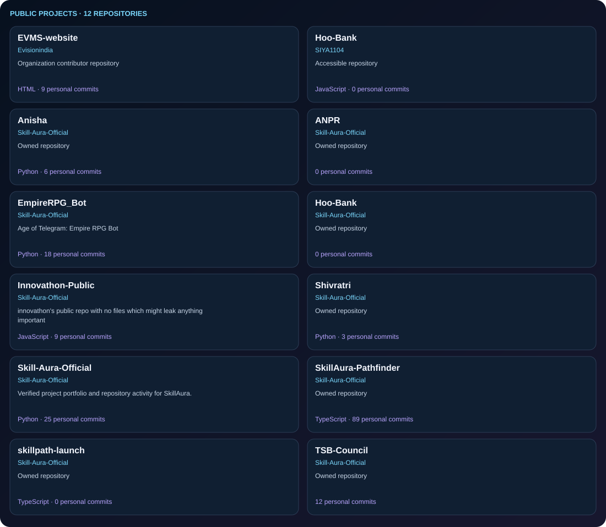

<picture><source media="(max-width: 600px)" srcset="assets/hero-mobile.svg"></picture>

# Jatin Dalal · SkillAura

I develop E-VMS camera and recording workflows and work on CAAMOO’s conversational interface for investigating CCTV footage.

## Personal engineering history

Snapshot 07 Nov 2026, 06:52 UTC. Coverage **PARTIAL**. Private coverage **Partial**.

<picture><source media="(max-width: 600px)" srcset="assets/activity-mobile.svg"></picture>

Read the activity figures as text

| My activity | Public | Private |
|---|---:|---:|
| Repositories with activity | 8 | 10 |
| Commits | 168 | 499 |
| PRs opened | 0 | 4 |
| Issues opened | 0 | 0 |
| Reviews submitted | 0 | 0 |
| Issue / PR comments | 0 | 0 |
| Review comments | 0 | 0 |
| Releases | 2 | 7 |
| Discussions | 0 | 0 |

<picture><source media="(max-width: 600px)" srcset="assets/timeline-mobile.svg"></picture>

[Complete public project directory](PUBLIC_PROJECTS.md) · [How activity is counted](METHODOLOGY.md)

Explore every year

2026

| My activity | Public | Private |
|---|---:|---:|
| Commits | 165 | 494 |
| PRs opened | 0 | 4 |
| Issues opened | 0 | 0 |
| Reviews submitted | 0 | 0 |
| Issue / PR comments | 0 | 0 |
| Review comments | 0 | 0 |
| Releases | 2 | 7 |
| Discussions | 0 | 0 |

2025

| My activity | Public | Private |
|---|---:|---:|
| Commits | 3 | 5 |
| PRs opened | 0 | 0 |
| Issues opened | 0 | 0 |
| Reviews submitted | 0 | 0 |
| Issue / PR comments | 0 | 0 |
| Review comments | 0 | 0 |
| Releases | 0 | 0 |
| Discussions | 0 | 0 |

## Product work

**E-VMS** · Camera onboarding, recording and playback workflows for E-Vision India's video-management product.

**CAAMOO** · Conversational CCTV investigation, follow-up and inspectable evidence. Ishika leads CAAMOO and its training work; I contribute to the web and investigation interface.

## Complete public projects

Every discovered public repository is included below. Activity reflects my account-linked work.

<picture><source media="(max-width: 600px)" srcset="assets/projects-mobile.svg"></picture>

Open every repository link

**Owned projects · 9**

- [Skill-Aura-Official/Anisha](https://github.com/Skill-Aura-Official/Anisha) · owned
- [Skill-Aura-Official/ANPR](https://github.com/Skill-Aura-Official/ANPR) · owned
- [Skill-Aura-Official/EmpireRPG_Bot](https://github.com/Skill-Aura-Official/EmpireRPG_Bot) · owned
- [Skill-Aura-Official/Innovathon-Public](https://github.com/Skill-Aura-Official/Innovathon-Public) · owned
- [Skill-Aura-Official/Shivratri](https://github.com/Skill-Aura-Official/Shivratri) · owned
- [Skill-Aura-Official/Skill-Aura-Official](https://github.com/Skill-Aura-Official/Skill-Aura-Official) · owned
- [Skill-Aura-Official/SkillAura-Pathfinder](https://github.com/Skill-Aura-Official/SkillAura-Pathfinder) · owned
- [Skill-Aura-Official/skillpath-launch](https://github.com/Skill-Aura-Official/skillpath-launch) · owned
- [Skill-Aura-Official/TSB-Council](https://github.com/Skill-Aura-Official/TSB-Council) · owned

**Organization and professional work · 1**

- [Evisionindia/EVMS-website](https://github.com/Evisionindia/EVMS-website) · organization contributor

**Forks and collaborations · 2**

- [SIYA1104/Hoo-Bank](https://github.com/SIYA1104/Hoo-Bank) · accessible
- [Skill-Aura-Official/Hoo-Bank](https://github.com/Skill-Aura-Official/Hoo-Bank) · owned

[Open the full repository metrics and activity index](PUBLIC_PROJECTS.md)

## Technologies

Technologies verified in project source and configuration across my portfolio.

**💻 Languages** 
`Batchfile` `CSS` `Go` `HTML` `JavaScript` `PHP` `PowerShell` `Python` `Shell` `SQL` `TypeScript`

**🎨 Frontend & UI** 
`Bootstrap` `Framer Motion` `Lucide` `Next.js` `Radix UI` `React` `React Hook Form` `React Icons` `React Router` `Recharts` `Tailwind CSS` `TanStack Query` `Three.js` `Vite` `Zustand`

**🔌 Backend & APIs** 
`aiohttp` `Axios` `bcrypt` `Express` `FastAPI` `Fastify` `HTTPX` `JWT` `Node.js` `OAuth` `OpenAPI` `Pydantic` `Python Cryptography` `Requests` `REST APIs` `Uvicorn` `WebSockets` `Zod`

**🗄️ Databases & Storage** 
`Drizzle ORM` `Firebase` `Microsoft Excel` `MongoDB` `MySQL` `PostgreSQL` `Redis` `SQLAlchemy` `SQLite` `Supabase`

**🧠 AI, ML & Inference** 
`NumPy` `Ollama` `ONNX Runtime` `OpenAI SDK` `OpenAI-compatible API` `Pillow` `Qwen` `YOLO` `YOLOX`

**🎥 Video & Camera Systems** 
`FFmpeg` `HLS` `MediaMTX` `ONVIF` `OpenCV` `RTSP` `WebRTC`

**📦 Infrastructure & Delivery** 
`Docker` `Docker Compose` `GitHub Actions` `Nginx` `systemd`

**🧪 Development & Testing** 
`ESLint` `Git` `Node.js test runner` `npm` `pip` `Playwright` `pytest` `Python unittest` `Testing Library` `Vitest`
