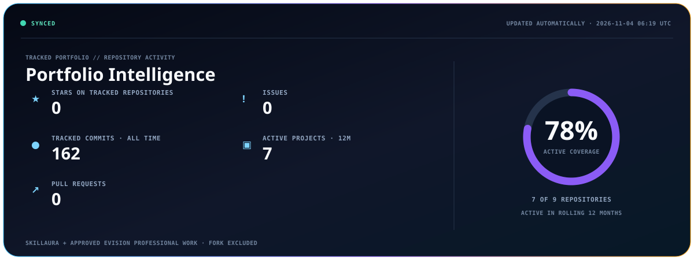
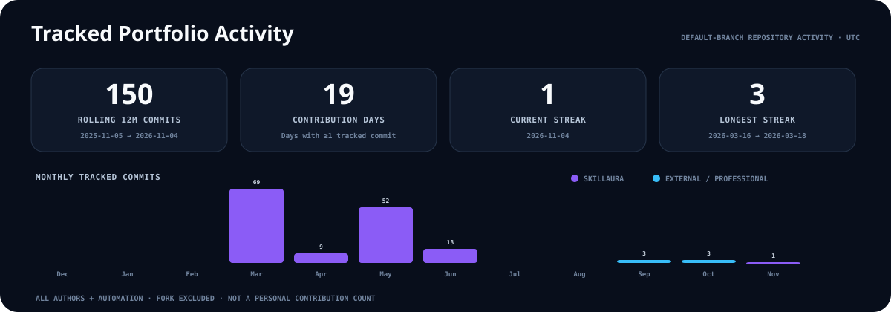
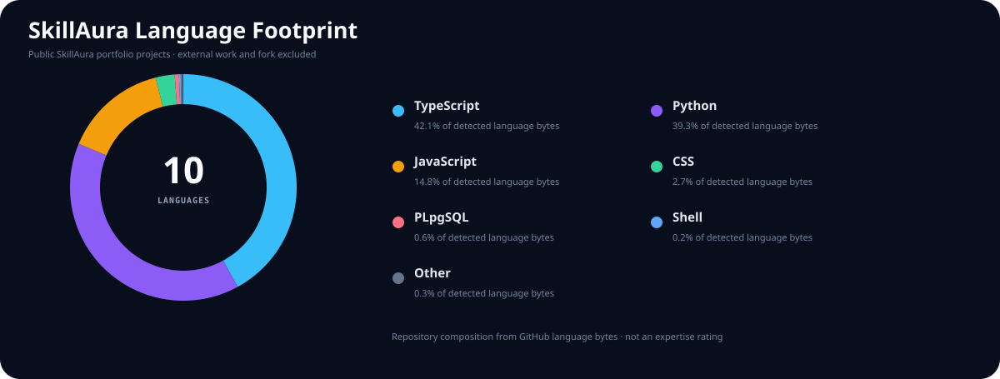
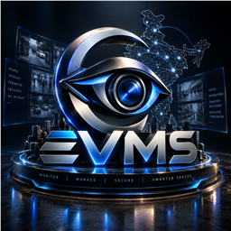
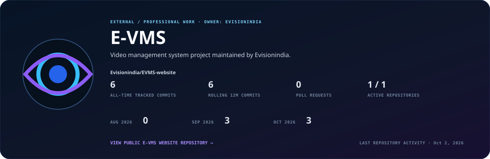
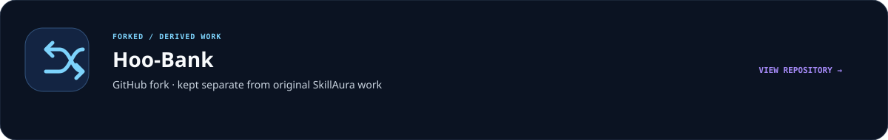

  

A portfolio of software products, web platforms, automation projects, and engineering work.

## Total Tracked Portfolio Activity

Repository-wide activity for public projects. All authors and automation are included. 10 public repositories owned by SkillAura, including forks and the profile repository.

| Activity category | Repositories | All-time commits | Current year | Rolling 12m | Active 12m |
|---|---:|---:|---:|---:|---:|
| SkillAura | 8 | 156 | 144 | 144 | 6 |
| External / professional · Evisionindia | 1 | 6 | 6 | 6 | 1 |
| **Total tracked portfolio** | **9** | **162** | **150** | **150** | **7** |

<picture>
  <source media="(max-width: 600px)" srcset="./assets/github-stats-mobile.svg">
  
</picture>

## Contribution Activity

<picture>
  <source media="(max-width: 600px)" srcset="./assets/contribution-activity-mobile.svg">
  
</picture>

## SkillAura Language Footprint

Language bytes remain SkillAura-only so external Evisionindia repositories are not silently mixed into the organization footprint.

## Technology Footprint

<kbd>TypeScript</kbd> &nbsp; <kbd>Python</kbd> &nbsp; <kbd>JavaScript</kbd> &nbsp; <kbd>CSS</kbd> &nbsp; <kbd>PLpgSQL</kbd> &nbsp; <kbd>Shell</kbd>

Technologies appearing in portfolio repositories. This is a repository footprint, not an expertise ranking.

## Recently Updated Projects

A neutral view of the four public SkillAura repositories with the latest GitHub activity.

<picture>
  <source media="(max-width: 600px)" srcset="./assets/recent-projects-mobile.svg?v=2">
  
</picture>

[ANPR](https://github.com/Skill-Aura-Official/ANPR) · [EmpireRPG\_Bot](https://github.com/Skill-Aura-Official/EmpireRPG_Bot) · [TSB-Council](https://github.com/Skill-Aura-Official/TSB-Council) · [Anisha](https://github.com/Skill-Aura-Official/Anisha)

[ANPR `74e3779`](https://github.com/Skill-Aura-Official/ANPR/commit/74e3779a192d829c634bc0affd278026a05b9dda) · [EmpireRPG_Bot `e26ed54`](https://github.com/Skill-Aura-Official/EmpireRPG_Bot/commit/e26ed54716e6528720f38699a264e5e610264e20) · [TSB-Council `eb665cd`](https://github.com/Skill-Aura-Official/TSB-Council/commit/eb665cdd862f6c5830b94da244ade6f813541fd6) · [Anisha `b920971`](https://github.com/Skill-Aura-Official/Anisha/commit/b920971ae477b848237479602f0eab643f960b2f) · [Innovathon-Public `725a63c`](https://github.com/Skill-Aura-Official/Innovathon-Public/commit/725a63c4c9227bb03c8156f15d54b4e0c8a78932)

## SkillAura Project Directory

<picture>
  <source media="(max-width: 600px)" srcset="./assets/public-projects-mobile.svg?v=2">
  
</picture>

[Anisha](https://github.com/Skill-Aura-Official/Anisha) · [ANPR](https://github.com/Skill-Aura-Official/ANPR) · [EmpireRPG\_Bot](https://github.com/Skill-Aura-Official/EmpireRPG_Bot) · [Innovathon-Public](https://github.com/Skill-Aura-Official/Innovathon-Public) · [Shivratri](https://github.com/Skill-Aura-Official/Shivratri) · [SkillAura-Pathfinder](https://github.com/Skill-Aura-Official/SkillAura-Pathfinder) · [skillpath-launch](https://github.com/Skill-Aura-Official/skillpath-launch) · [TSB-Council](https://github.com/Skill-Aura-Official/TSB-Council)

## Private / Closed-Source Projects

Private project details and activity counts are unavailable in the public snapshot.

## E-VMS · External Professional Work

One professional portfolio project with metrics from the public website repository. Repository owner: **Evisionindia**.

[Evisionindia/EVMS-website](https://github.com/Evisionindia/EVMS-website)

## Forked / Derived Work

---

  Portfolio metrics are generated from tracked GitHub repository activity and refreshed every six hours. Last successful synchronization: 2026-11-04T19:49:59.729Z.

