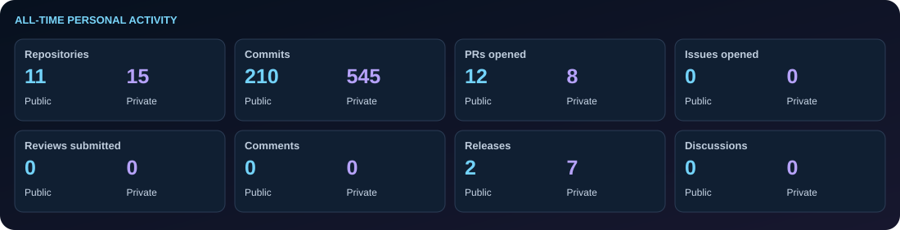

<picture><source media="(max-width: 600px)" srcset="assets/hero-mobile.svg"></picture>

# Jatin Dalal · Software, AI & Automation

Hi, I’m Jatin. I build web applications, AI interfaces, community bots and automation. Through SkillAura, I work on career tools and hackathon experiences; my other projects span backend integrations, developer tooling and community work.

At E-Vision India, I contribute to team-owned products for video management, plate recognition and AI-assisted investigations. I enjoy connecting the interface to what happens behind it: the data, permissions and integrations that make a workflow useful. This profile brings together my personal projects and contributions, with ownership and team credits kept visible.

[Public projects](#complete-public-projects) · [Closed-source work](#private--closed-source-projects) · [Technologies](#technologies) · [Activity](#personal-engineering-history)

### Work at a glance

- **💻 Web products** · [SkillAura PathFinder AI](https://github.com/Skill-Aura-Official/SkillAura-Pathfinder) and [Innovathon](https://github.com/Skill-Aura-Official/Innovathon-Public)
- **🌱 Recent development work** · [WebGuide AI](#webguide-ai), [TenderIQ](#tenderiq) and [Tutor](#tutor)
- **🤖 Bots and communities** · [Anisha](https://github.com/Skill-Aura-Official/Anisha) and [Empire RPG](https://github.com/Skill-Aura-Official/EmpireRPG_Bot)
- **🧰 Developer tools and automation** · [Portfolio collection and attribution](METHODOLOGY.md)
- **🎥 Video systems and AI** · Contributions to E-Vision’s E-VMS, CAAMOO and ANPR workflows; [roles and team credits below](#private--closed-source-projects)

## Private / Closed-source Projects

Development contributions across personal, team and customer work. Repositories remain private where applicable; links lead only to public pages. Ownership and lead credits are shown separately.

### [WebGuide AI](https://webguide-ai-live.plushmole8.chatgpt.site/)

*Owner and lead: Riya Yadav · Development contributor: Jatin Dalal*

Voice-assisted website guidance for blind and low-vision users. I contribute to its development. Riya Yadav owns and leads the project.

### TenderIQ

*Personal repository · Development contribution*

A tender-discovery and bid-management application. I contribute to its development.

### Tutor

*Personal repository · Development contribution*

A private Next.js web application. I contribute to its development.

### [E-VMS](https://github.com/Evisionindia/EVMS-website)

*E-Vision India*

E-Vision India’s video-management product. I contribute to camera, recording, playback and operator workflows.

### CAAMOO

*E-Vision India*

A conversational CCTV investigation application. Ishika leads CAAMOO and its training work. I contribute to the web and investigation interface.

### [ANPR](https://github.com/Skill-Aura-Official/ANPR)

*Personal repository and E-Vision integration*

A plate-recognition application for reviewing vehicle observations. I contribute to plate review, evidence and integration workflows.

### [Innovathon](https://github.com/Skill-Aura-Official/Innovathon-Public)

*SkillAura*

SkillAura’s hackathon platform. I worked on the event web experience.

### [Age of Telegram · Empire RPG](https://github.com/Skill-Aura-Official/EmpireRPG_Bot)

*Personal repository for a community game*

A text-based RPG bot for Telegram groups. I contributed to its bot code.

### Aurora Ink Genie

*Personal repository*

I contributed to the React web prototype and iterated on its interface.

### Beauty and wellness website

*Customer project contribution*

I contributed to a service catalogue, campaign pages and administration workflows for a beauty and wellness website.

### Nyther

*The Sovereign Brotherhood community*

I contributed to a Telegram automation project with userbot deployment and management workflows.

### Kiru

*Personal repository*

I contributed to the web application for an AI-assisted recruitment project, including application and hiring workflows.

### Nexus VMS

*E-Vision India*

I contributed to an earlier E-Vision India video-management codebase and its engineering workflow.

## Complete public projects

Every public repository in the current inventory is linked below, including forks and collaborations. Repository ownership does not imply sole authorship. Detailed commit counts stay in the [activity index](PUBLIC_PROJECTS.md).

**Owned projects · 9**

- **[Skill-Aura-Official/Anisha](https://github.com/Skill-Aura-Official/Anisha)** — Telegram music bot with group-call media playback and queue controls.

- **[Skill-Aura-Official/ANPR](https://github.com/Skill-Aura-Official/ANPR)** — Vehicle-observation and plate-review prototype with image evidence and alerts.

- **[Skill-Aura-Official/EmpireRPG_Bot](https://github.com/Skill-Aura-Official/EmpireRPG_Bot)** — A text-based empire-building RPG bot for Telegram communities.

- **[Skill-Aura-Official/Innovathon-Public](https://github.com/Skill-Aura-Official/Innovathon-Public)** — SkillAura’s hackathon platform: teams, submissions, judging and leaderboards.

- **[Skill-Aura-Official/Shivratri](https://github.com/Skill-Aura-Official/Shivratri)** — A Python sketch-animation project using a Shiva illustration.

- **[Skill-Aura-Official/Skill-Aura-Official](https://github.com/Skill-Aura-Official/Skill-Aura-Official)** — My portfolio, approved project contributions and GitHub activity reporting.

- **[Skill-Aura-Official/SkillAura-Pathfinder](https://github.com/Skill-Aura-Official/SkillAura-Pathfinder)** — A career-development frontend with onboarding, quests, skill trees and progress views.

- **[Skill-Aura-Official/skillpath-launch](https://github.com/Skill-Aura-Official/skillpath-launch)** — A career-platform prototype with candidate, recruiter and job-discovery interfaces.

- **[Skill-Aura-Official/TSB-Council](https://github.com/Skill-Aura-Official/TSB-Council)** — The Sovereign Brotherhood’s community governance, moderation and policy documents.

**Organization and professional work · 2**

- **[Evisionindia/.github](https://github.com/Evisionindia/.github)** — E-Vision India’s company profile, product portfolio and service information.

- **[Evisionindia/EVMS-website](https://github.com/Evisionindia/EVMS-website)** — E-VMS product website, download information and enquiry workflows.

**Forks and collaborations · 2**

- **[SIYA1104/Hoo-Bank](https://github.com/SIYA1104/Hoo-Bank)** — Upstream banking-style demonstration by SIYA1104; retained here with its original ownership credit.

- **[Skill-Aura-Official/Hoo-Bank](https://github.com/Skill-Aura-Official/Hoo-Bank)** — My fork of SIYA1104’s banking-style demonstration, with registration, login and dashboard interfaces.

[Open the full repository metrics and activity index](PUBLIC_PROJECTS.md)

## Technologies

Technologies verified in project source and configuration across my portfolio.

**💻 Languages** 
`Batchfile` `CSS` `Go` `HTML` `JavaScript` `PHP` `PowerShell` `Python` `Shell` `SQL` `TypeScript`

**🎨 Frontend & UI** 
`Bootstrap` `Framer Motion` `Lucide` `Next.js` `Radix UI` `React` `React Hook Form` `React Icons` `React Router` `Recharts` `Tailwind CSS` `TanStack Query` `Three.js` `Vite` `Zustand`

**🔌 Backend & APIs** 
`aiohttp` `Axios` `bcrypt` `Beautiful Soup` `Celery` `Express` `FastAPI` `Fastify` `Helmet` `HTTPX` `JWT` `Node.js` `OAuth` `OpenAPI` `Pydantic` `Python Cryptography` `Requests` `REST APIs` `Telegram Bot API` `Uvicorn` `WebSockets` `Zod`

**🗄️ Databases & Storage** 
`Alembic` `Drizzle ORM` `Firebase` `Microsoft Excel` `MongoDB` `MySQL` `PostgreSQL` `Redis` `SQLAlchemy` `SQLite` `Supabase`

**🧠 AI, ML & Inference** 
`llama.cpp` `NumPy` `Ollama` `ONNX Runtime` `OpenAI SDK` `OpenAI-compatible API` `Pillow` `Qwen` `YOLO` `YOLOX`

**🎥 Video & Camera Systems** 
`FFmpeg` `HLS` `MediaMTX` `ONVIF` `OpenCV` `RTSP` `WebRTC`

**📦 Infrastructure & Delivery** 
`Docker` `Docker Compose` `GitHub Actions` `Nginx` `SSH` `systemd`

**🧪 Development & Testing** 
`ESLint` `Git` `Node.js test runner` `npm` `pip` `Playwright` `pytest` `Python unittest` `Testing Library` `Vitest`

## Personal engineering history

Snapshot 15 Nov 2026, 19:59 UTC. Coverage **PARTIAL**. Private coverage **Partial**.

These are recorded GitHub events across retrievable history, not a measure of all development work. Project contributions above also include work confirmed by me that is not linked to my GitHub account in commit metadata.

**Different scopes:** the repository directory lists projects; ‘Repos with activity’ counts repositories with recorded account-linked events. GitHub’s native calendar below uses its own contribution rules and time window, so its total will differ. [Counting details](METHODOLOGY.md)

<picture><source media="(max-width: 600px)" srcset="assets/activity-mobile.svg"></picture>

Read the activity figures as text

| My activity | Public | Private |
|---|---:|---:|
| Repositories with activity | 11 | 15 |
| Commits | 210 | 545 |
| PRs opened | 12 | 8 |
| Issues opened | 0 | 0 |
| Reviews submitted | 0 | 0 |
| Issue / PR comments | 0 | 0 |
| Review comments | 0 | 0 |
| Releases | 2 | 7 |
| Discussions | 0 | 0 |

<picture><source media="(max-width: 600px)" srcset="assets/timeline-mobile.svg"></picture>

[Complete public project directory](PUBLIC_PROJECTS.md) · [How activity is counted](METHODOLOGY.md)

Explore every year

2026

| My activity | Public | Private |
|---|---:|---:|
| Commits | 207 | 540 |
| PRs opened | 12 | 8 |
| Issues opened | 0 | 0 |
| Reviews submitted | 0 | 0 |
| Issue / PR comments | 0 | 0 |
| Review comments | 0 | 0 |
| Releases | 2 | 7 |
| Discussions | 0 | 0 |

2025

| My activity | Public | Private |
|---|---:|---:|
| Commits | 3 | 5 |
| PRs opened | 0 | 0 |
| Issues opened | 0 | 0 |
| Reviews submitted | 0 | 0 |
| Issue / PR comments | 0 | 0 |
| Review comments | 0 | 0 |
| Releases | 0 | 0 |
| Discussions | 0 | 0 |

