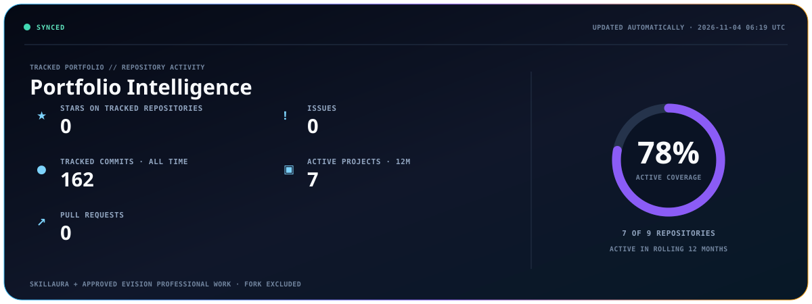
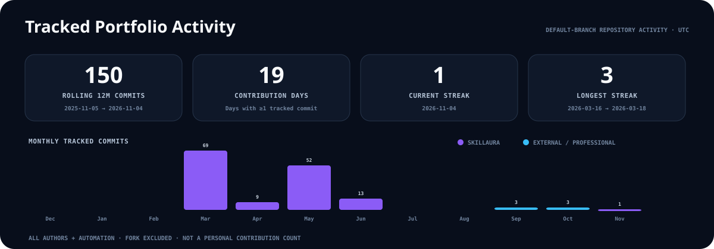
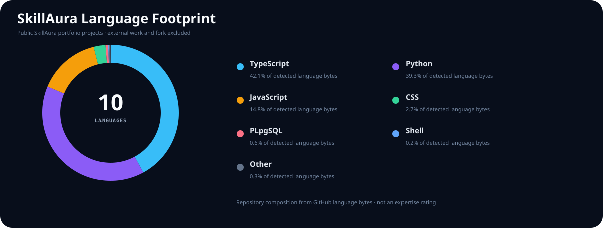
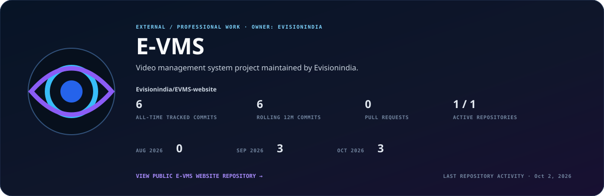
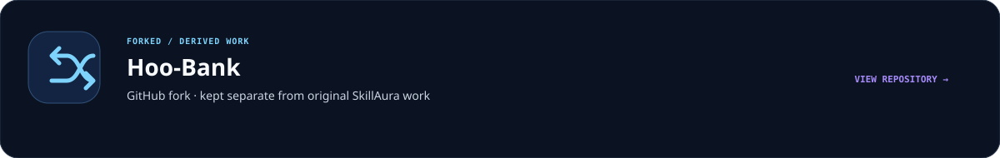

{{HERO_BADGES}}

{{PROFILE_SUMMARY}}

## Personal GitHub activity

 [Open the latest successful run and its activity table](https://github.com/Skill-Aura-Official/Skill-Aura-Official/actions/workflows/refresh-profile.yml?query=branch%3Amain+is%3Asuccess).

Each run summary shows public and aggregate private counts for the last 30 UTC dates, its collection time, coverage and the time it becomes stale (45 minutes later). The workflow is scheduled at minutes 07, 22, 37 and 52 UTC each hour. GitHub can delay scheduled runs.

| Metric | What the collector counts |
|---|---|
| Commits | Non-merge commits whose primary GitHub author links to my account. Counted by committer date across visible branch heads, including forks, once per SHA. A squash has a new SHA and counts separately if its source commits are still reachable. Bot-committed changes and automated profile refreshes are excluded. |
| Pull requests and issues | Distinct PRs and issues I opened, by creation date. |
| Reviews | Distinct reviews I submitted, by submission date, including multiple reviews on a PR. |

Repository access alone adds no activity. A commit visible publicly and privately is counted once in the public column. Private coverage is limited to repositories visible to the authorized collector. UNKNOWN means the collector cannot establish a private count. A failed refresh leaves the last valid snapshot available. No refresh creates a Git commit.

GitHub administers the native contribution graph separately, using its own event rules, visibility settings and update timing. [GitHub contribution rules](https://docs.github.com/en/account-and-profile/reference/profile-contributions-reference)

## Repository-wide public portfolio snapshot

Repository-wide activity for public projects. All authors and automation are included. {{PUBLIC_COUNT}} public repositories owned by SkillAura, including forks and the profile repository.

{{ACTIVITY_SCOPE_TABLE}}

<picture>
  <source media="(max-width: 600px)" srcset="./assets/github-stats-mobile.svg">
  
</picture>

## Repository-wide activity in the portfolio snapshot

<picture>
  <source media="(max-width: 600px)" srcset="./assets/contribution-activity-mobile.svg">
  
</picture>

## SkillAura Language Footprint

Language bytes remain SkillAura-only so external Evisionindia repositories are not silently mixed into the organization footprint.

## Technology Footprint

{{TECHNOLOGY_CHIPS}}

Technologies appearing in portfolio repositories. This is a repository footprint, not an expertise ranking.

## Recently Updated Projects

A neutral view of the four public SkillAura repositories with the latest GitHub activity.

<picture>
  <source media="(max-width: 600px)" srcset="./assets/recent-projects-mobile.svg?v=2">
  
</picture>

{{RECENT_PROJECT_LINKS}}

{{RECENT_COMMITS}}

## SkillAura Project Directory

<picture>
  <source media="(max-width: 600px)" srcset="./assets/public-projects-mobile.svg?v=2">
  
</picture>

{{PUBLIC_PROJECT_LINKS}}

## Private / Closed-Source Projects

Private engineering activity is reported only as personal aggregate counts in the linked workflow summary, subject to collector access.

## E-VMS · External Professional Work

One professional portfolio project with metrics from the public website repository. Repository owner: **Evisionindia**.

[Evisionindia/EVMS-website](https://github.com/Evisionindia/EVMS-website)

## Forked / Derived Work

---

  Public portfolio graphics reflect a historical repository-wide snapshot. Snapshot generated {{SYNC}}.

